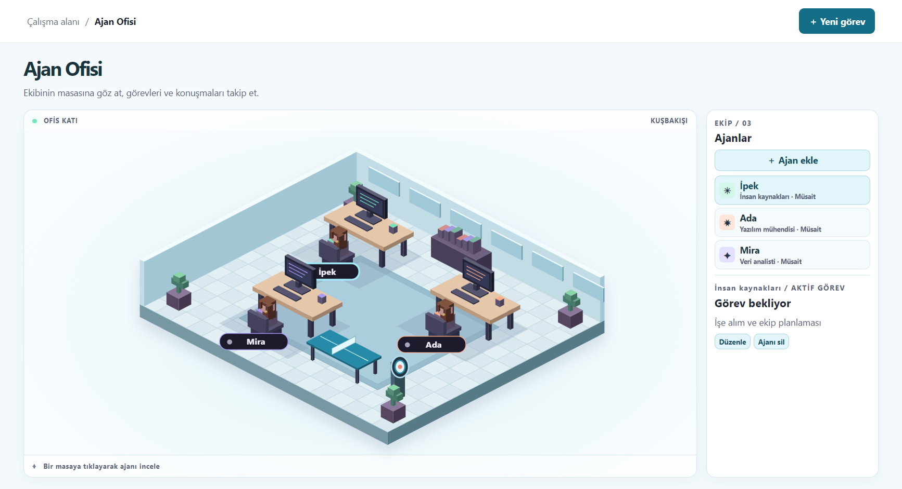
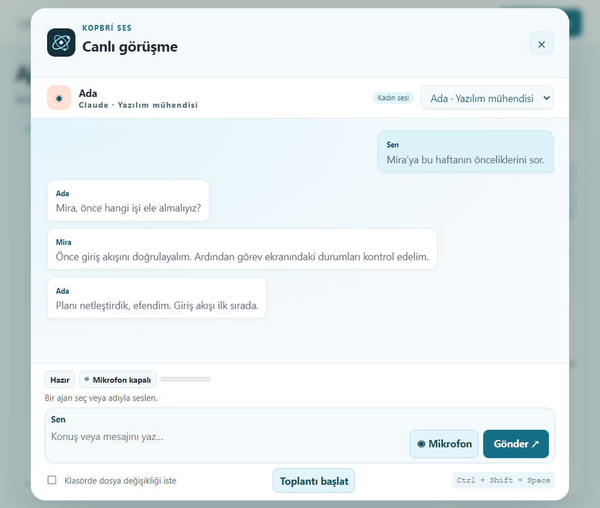

<p align="center"></p>

# kopbri

Windows masaüstünde Codex, Claude Code ve Gemini CLI ile çalışan sesli bir ajan ofisi.



## Kurulum

1. [GitHub Releases](https://github.com/bakar-technology/kopbri/releases) bölümünden Windows x64 kurucusunu indirip çalıştır.
2. Türkçe veya İngilizceyi seç. Kurucu eksik ajan araçlarını internet üzerinden yükler.
3. Uygulamada **Ayarlar → Bağlantılar** bölümünden kullanmak istediğin sağlayıcıya giriş yap.
4. Çalışma klasörünü seç. İK ajanına “Yeni bir analist işe al” diyerek ekibini kurabilirsin.

Windows kurucusuna çevrimdışı dikte ve seslendirme bileşenleri dahil. Sesli görüşme için Windows mikrofon izni gerekir. Model yanıtları bağlı sağlayıcı hesabını kullanır. macOS paketleri, yerel CLI’larla çalıştırılan imzasız önizlemelerdir. Windows’a özgü çevrimdışı konuşma kaynakları ve basılı tutma desteği macOS paketine dahil değildir.

## Günlük kullanım

| İşlem | Nasıl yapılır |
| --- | --- |
| Hızlı arama | **Ctrl + Space** |
| Sesli görüşme | **Ctrl + Shift + Space** tuşlarını konuşurken basılı tut ve göndermek için bırak |
| Ajan değiştirme | “Ada’yla konuşacağım” de veya ofiste masasını seç |
| Ekip arkadaşına danışma | “Mira’ya proje risklerini sor” de |
| Toplantı | Ses penceresinde **Toplantı başlat** seçeneğini kullan ve konuyu söyle |
| Görev kaydetme | “Görev: projeyi incele” veya son isteğin ardından “Görevlere kaydet” de |
| Ajan işe alma | “Yeni bir analist işe al” de. İK bağlı sağlayıcıların bütçelerini kontrol eder |

Görevlerde analist planı, yürütücü ajan ve bütçe nedeniyle yapılan devirler kaydedilir. Dosya değişiklikleri çalışma klasörü izinlerine tabidir.



## GitHub ve Cloudflare

**Ayarlar → Bağlantılar** bölümünden GitHub profilini bağlayıp bir depoyu kopyalayarak çalışma alanı olarak açabilirsin. Cloudflare bağlantısı, uygun API belirteciyle bölgeleri ve Worker’ları görüntüler. Görüntüleme için **Zone Read** ve **Workers Scripts Read** izinlerini kullan.

## E-posta

**Ayarlar → Bağlantılar → E-posta** altında Gmail, Outlook veya özel bir IMAP/SMTP posta kutusu bağla. “Mail geldi mi?” dediğinde kopbri bağlı gelen kutularından okunmamış iletilerin konu başlıklarını listeler.

- **Gmail** için Google Cloud’da Gmail API’yi etkinleştir ve **Desktop app** OAuth istemcisi oluştur. İstemci kimliği ve parolasını kopbri’ye gir.
- **Outlook** için Microsoft Entra’da uygulama kaydı oluştur. Masaüstü yönlendirmesine `http://localhost` ekle ve **Mail.Read** yetkisi tanımla. Gönderim için **Mail.Send** yetkisi gerekir.
- **Hostinger** için kutunun tam e-posta adresini ve parolasını kullan. Standart değerler IMAP `imap.hostinger.com:993` ve SMTP `smtp.hostinger.com:465` şeklindedir. [Hostinger yapılandırma rehberi](https://www.hostinger.com/support/1575756-how-to-get-email-account-configuration-details-for-hostinger-email/)

Ajanın yazdığı taslakta alıcıyı, konuyu ve içeriği düzenleyebilirsin. Gönderim ayrı bir onay penceresi gerektirir. Gmail ve Outlook’ta gönderme erişimi hesap bağlanırken isteğe bağlıdır.

## Kaynak koddan çalıştırma

Windows x64 üzerinde Node.js ve npm ile:

```powershell
npm ci
npm start
```

Kurulu ajan araçlarından yararlanmak için sağlayıcıların CLI’larını yükleyip oturum aç. Çevrimdışı ses, araç kurucusu ve paketli GitHub CLI için [yerel çalışma ortamı dosyaları](docs/build.md) gerekir.

Üçüncü taraf kaynaklar ve lisanslar [lisanslar](licenses/README.md) altında listelenmiştir.
